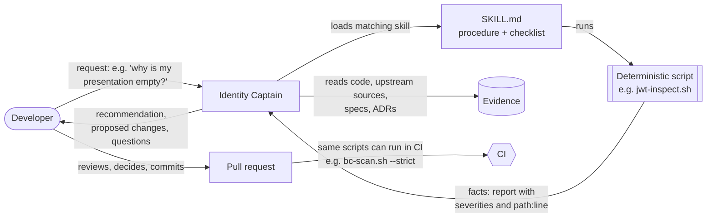

# How the Identity Captain skills work

The Captain's skills split each development task into two parts:

1. **Deterministic scripts collect the facts.** They answer "what is true in this repository and in upstream EDC
   IdentityHub right now?": which upstream types, settings, endpoints and schemas changed between two versions, where a
   setting lives across code, charts and the compose stack, which migrations are released, which API operations the
   collections cover, what a DID document or token really contains. The same input always produces the same output.
   They can be read, reviewed, run by anyone, and run in CI.
2. **The Captain turns the facts into recommendations.** It reads the script output together with the code, the specs
   and the project's decision records. Then it explains what the facts mean, recommends what to do, proposes concrete
   changes (code, config, migration, collection, docs), and asks for the decisions only a human can make.

**The human decides and reviews.** Nothing is pushed or published without you.

<!-- TOC -->
- [Why split it this way](#why-split-it-this-way)
- [The flow](#the-flow)
- [Anatomy of a skill](#anatomy-of-a-skill)
- [Design principles for the scripts](#design-principles-for-the-scripts)
- [Worked examples](#worked-examples)
- [Catalog](#catalog)
- [Writing a new skill](#writing-a-new-skill)
- [Limits](#limits)
<!-- TOC -->

## Why split it this way

| | Deterministic script | Captain (AI agent) |
|---|---|---|
| Good at | Exhaustive, repeatable fact-finding: diffs, inventories, cross-references, version comparisons, decoding | Interpretation, prioritisation, explaining *why*, adapting a pattern to a new case, writing prose and code |
| Weak at | Judgement, context, "is this acceptable?" | Remembering facts precisely: upstream renames often (`v1alpha` → `v1beta`, roles → scopes, base64 → verbatim participant ids), and memory goes stale |
| Output | Reports with severities and `path:line` | Recommendations, patches, documents, questions |
| Trust model | Inspect the script once, then trust its output | Check its evidence, review its proposal |

## The flow



1. You describe the goal in your own words.
2. The Captain matches it to a skill from the skill's `description` and loads its `SKILL.md`.
3. It runs the skill's script(s) and reads the report.
4. It verifies and deepens the facts by opening the code the report points to, the upstream sources at the pinned
   version (`ih-upstream-sources`), the specs and the decision records.
5. It answers with a recommendation and the concrete next step. When you ask, it implements the change, again following
   the skill's checklist.
6. You review. The same deterministic checks can guard the PR in CI.

## Anatomy of a skill

```text
.claude/skills/<skill-name>/
├── SKILL.md          # front matter (name, description) + procedure, conventions, checklist, pitfalls
└── scripts/
    └── <tool>.sh     # deterministic helper(s): read-only unless they explicitly scaffold or --write
```

- **`description`** (front matter) decides *when* the skill is used. It names the task and the trigger phrases.
- **The `SKILL.md` body** is the procedure: where the truth lives in this repo, the house conventions, a checklist, and
  how to debug typical failures.
- **The scripts** are the deterministic part. The procedure says when to run them and how to read their output.

Claude Code and GitHub Copilot both load skills from `.claude/skills/`. One copy serves both tools.

## Design principles for the scripts

1. **Evidence, version-pinned.** Upstream facts come from the exact version in `gradle/libs.versions.toml`, read from
   sources jars resolved through the four BOMs this repository ships. Local clones and memory are never the source.
2. **Read-only by default.** Scripts never modify existing repository files, except where a flag says so
   (`--write`) or a command scaffolds new files and prints the remaining manual steps.
3. **Reproduce CI where CI exists.** `dash-check.sh` uses the same `allDependencies` extraction as `dash-scan.yml`;
   `dcp-e2e.sh` mirrors `postman-e2e-test.yaml` step by step (profiles, health wait, key extraction, newman pin, folders);
   `api-inventory.sh drift` runs the `OpenAPI-Specs-Up-To-Date` job.
4. **Honest heuristics.** Where a script guesses, it says so and grades the finding (BLOCKER, BREAKING, HIGH, WARN).
   The Captain confirms each finding.
5. **Output for humans and agents.** Plain text tables, one finding per line, `path:line`, severities, next steps.
6. **Portable.** bash 3.2+ (stock macOS) and Linux, standard tools plus `node` for JSON and JWTs.
7. **Tested against real history.** For example:
   - `bump-impact.sh 0.17.0 0.18.0` reproduces the 0.18.0 upgrade (#339/#344): 54 endpoints moved `/v1alpha` →
     `/v1beta`, `PUT …/roles` → `PUT …/scopes`, `edc.encryption.strict` removed upstream, and every collection, doc and
     UI file that still used the old paths.
   - `draft-migration-guide.sh` since `v0.4.1` surfaced chart values removed from the persistence charts
     (`postgresql.primary`, `postgresql.readReplicas`) and a renamed logging formatter key that the guide does not yet
     mention.
   - `dash-check.sh` reproduces CI's 400 Gradle coordinates exactly.

## Worked examples

### Debugging an empty presentation

> "The provider connector terminates the negotiation; it says my credentials are missing."

1. **Facts.** `did-inspect.sh <holder DID> --probe` confirms the DID resolves and the `CredentialService` endpoint
   answers. `jwt-inspect.sh` on the VP from the connector log shows a valid presentation with zero credentials.
2. **Recommendation.** The Captain compares the requested scope with the stored credential types, reads
   `TxScopeToCriterionTransformer` and the configured `tx.identityhub.scope.aliases`, and finds, for example, that the alias for the requested scope is missing.
3. **Proposal.** The exact setting and chart value, and the E2E folder that proves it.

### Adopting an upstream release

> "Plan the upgrade from EDC 0.18.0 to 0.19.0."

1. **Facts.** `bump-impact.sh 0.18.0 0.19.0`: changed types used by Tractus-X, settings and endpoints removed or added,
   schema deltas, and the collection/UI files that use removed paths.
2. **Recommendation.** The Captain reads the diffs of the high-impact types (`ih-src.sh diff`), with extra care for the
   ownership extensions and the scope transformer, and groups the work: compile fixes, behaviour changes, migrations,
   settings, collections, docs.
3. **Guard.** `bc-scan.sh`, the test suites and `dcp-e2e.sh run sql|memory`.

### Reviewing a pull request

> "Review PR #1234."

1. **Facts.** `bc-scan.sh <base>` reports released migrations edited, removed settings, Helm values and ConfigMap keys,
   removed API operations, security-sensitive modules, scope-mapping changes and missing follow-ups.
2. **Recommendation.** The Captain confirms each finding in the diff and adds what the scanner cannot see (authorization
   semantics, vault partitions, credential content). It proposes fixes.
3. **Decision for you.** Approve, request changes, or post comments (it drafts them with the comment template; you post).

## Catalog

See [`.claude/skills/README.md`](../../../.claude/skills/README.md) for every skill with its script.

| Skill | Deterministic part (facts) | Captain's part (judgement) |
|---|---|---|
| `ih-upstream-sources` | Upstream class, setting, endpoint or schema at an exact version; diffs | What the upstream behaviour means for Tractus-X |
| `upstream-edc-bump` | Changed types, settings, endpoints, schemas between versions | Upgrade plan, fixes, migrations, collection updates |
| `setting-lifecycle` | Every place a setting lives | Naming, deprecation, chart and doc changes |
| `breaking-change-guard` | Graded findings for a change set | Confirm, add what is missing, propose fixes |
| `sql-migration` | Subsystem status, next version, upstream comparison | DDL/DML, idempotency, data migration, rollout |
| `new-extension` | A module scaffold that builds green | Upstream vs config vs extension, design, wiring |
| `dcp-e2e-flow` | CI-equivalent stack and collection run | Root cause, collection design |
| `api-surface` | Contexts, operations, coverage, drift | API usage, auth, client changes |
| `identity-diagnostics` | DID document lint, decoded tokens, VPs, VCs | The failing link in the DCP chain, the fix |
| `dependencies-and-dash` | CI-equivalent dependency list, Dash result, file diff | Alternatives, IP review path |
| `migration-guide-and-adr` | Evidence since the last release; ADR skeleton | The guide, changelog and decision text |

## Writing a new skill

1. **Pick a recurring task** with a clear fact-finding part (look at what PRs and reviews repeatedly need).
2. **Write the script first**: deterministic and read-only (or explicit scaffolding), `--help` text in the header
   comment, `set -euo pipefail`, bash 3.2 compatible (no `\b` in awk/grep regexes on macOS, no `grep -P`), and the
   license header with the AI disclosure block if AI-assisted. Resolve sibling skills relative to the script
   (`$(dirname "${BASH_SOURCE[0]}")/../..`) so it also works on old checkouts.
3. **Validate it on real history** where you know the right answer, and keep the results for the PR description.
4. **Write `SKILL.md`**: a precise `description` with trigger phrases, then where the truth lives, the procedure, the
   conventions, a checklist and debugging tips. Keep it short and link long docs.
5. **Register it** in `.claude/skills/README.md`, the skill table in both agent files, and
   `.github/copilot-instructions.md`.
6. **Consider CI.** If the output is a pass/fail gate, it can run in a workflow (e.g. `bc-scan.sh --strict`). That is a
   decision for the maintainers.

## Limits

- Scripts are heuristics where they say so. A clean `bc-scan.sh` does not prove a change is compatible; review, tests
  and the E2E flow do the rest.
- `jwt-inspect.sh` decodes but does not verify signatures; signature verification is the verifier's job (and the E2E
  flow's).
- Some checks need Docker (E2E, Postgres) or network access (upstream sources, Eclipse Dash, DID resolution).
- The Captain proposes. Contributors remain responsible for what they submit, including the AI disclosure and the review
  it attests to.

## NOTICE

This work is licensed under the [CC-BY-4.0](https://creativecommons.org/licenses/by/4.0/legalcode).

- AI Disclosure: This file was entirely AI-generated. The AI-generated portions are made available under CC0-1.0 and
  not subject to the project's license. The human contributor has reviewed and verified that the content is correct.
- SPDX-License-Identifier: CC-BY-4.0 AND CC0-1.0
- SPDX-FileCopyrightText: 2026 Catena-X Automotive Network e.V.
- SPDX-FileCopyrightText: 2026 Contributors to the Eclipse Foundation
- Assisted-By: Claude Code (claude-opus-5-5)
- Source URL: <https://github.com/eclipse-tractusx/tractusx-identityhub>
